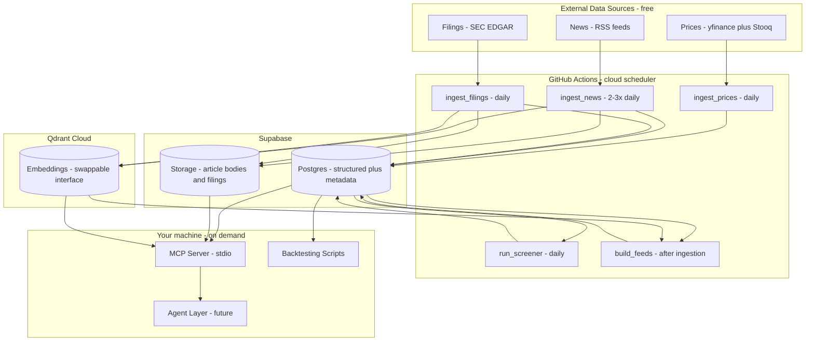
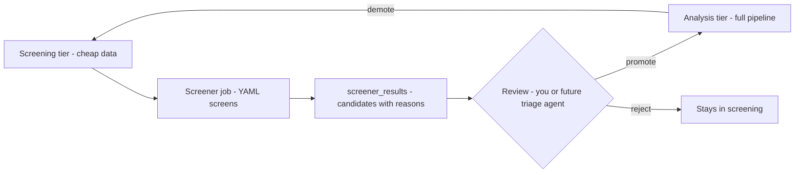

# Data Engineering Platform — Architecture & Plan

**Project:** financial-advisor (multi-agent investment committee)
**Scope of this document:** the Data Engineering platform only — ingestion, curation, screening, feeds, and the MCP interface. The agent layer is out of scope for now; only its contract with the platform is defined here.
**Status:** Planning — awaiting approval
**Companion document:** [`plans/ticker-universe.md`](ticker-universe.md) — ticker entry structure, selection criteria, starter list.

---

## 1. Vision

A multi-agent advisor where role-based agents (fundamental, technical, and sentiment analysts; bull/bear debaters; risk manager; judge) argue and produce **BUY / SELL / HOLD** recommendations for **swing trading** (holding periods of days to a month).

This platform is the foundation. It maintains a **two-tier universe**: a broad, cheap **screening tier** (~100–150 instruments: prices, fundamentals, headline news) from which a configurable **screener** surfaces candidates, and a narrow **analysis tier** (10–30 tickers) that gets the full pipeline. It curates data into versioned, role-scoped per-ticker **feeds** (which recombine into the full **Research Package** for the judge) and serves them to agents through an **MCP server**. Agents never call external APIs or query raw tables directly — the contract is the coupling point, which is what makes the future agent layer freely reconfigurable (add/remove agents, edit roles and prompts, zero platform changes).

---

## 2. Requirements & Settled Decisions

| Requirement | Decision |
|---|---|
| Trading horizon | Swing: days to a month. Weeks-to-month is the economic optimum given costs. |
| Universe structure | **Two tiers:** screening (~100–150, cheap data only) → screener → analysis (10–30, full pipeline). Funnel target: ~5–15 flagged/week → pick 1–3 → 3–8 open positions. |
| Agent configurability | Strict, versioned data contract served as **role-scoped feeds** (not one shared document). Agent roles/prompts/feed mappings live in the agent layer's config, never in the platform. |
| Agent interface | MCP server as a thin layer over a plain Python core library. |
| Price granularity | **Daily time bars** as the atomic grain. Tick data and dollar bars considered and rejected (see §14). |
| Time semantics | **Bitemporal** (`valid_from` + `ingested_at`), insert-only, point-in-time correct. |
| Data budget | Free sources first behind source-agnostic adapters; paid upgrade path documented. |
| Broker cost model | GBM tiered commission (currently 0.25%/side) + 16% IVA; FX spread placeholder; judge enforces min-edge ≥ 3× round-trip cost. |
| Market | US large-caps (via SIC) and Mexican stocks (BMV). Cost model handles both. |
| Infrastructure | **Cloud-first, all free tier:** Supabase DB (structured + metadata, 500 MB) + Supabase Storage (bodies/filings, 1 GB) + Qdrant Cloud (vectors, 1 GB) + GitHub Actions (orchestration, ~2,000 min/mo). No self-hosted servers. |

---

## 3. Architecture Overview



**Layer responsibilities:**

- **Source Adapters** — one per source, common interface `fetch(ticker, since) -> raw records`. Adding a source = one new adapter file + one YAML entry. Built-in rate limiting, retries with backoff, per-source enable/disable.
- **Raw Zone** — immutable, timestamped snapshots of every external response. Small payloads in Postgres JSONB; large payloads (article bodies, filing documents) in Supabase Storage with a `storage_path` pointer. Enables replay without re-hitting APIs.
- **Transformation & Enrichment** — normalization, indicator computation, XBRL parsing, sentiment scoring, embeddings (vector access behind a swappable interface: Qdrant now, pgvector possible).
- **Curated Zone** — Supabase Postgres: structured tables + news metadata. Single query point for everything except bodies (Storage) and vectors (Qdrant).
- **Screener** — daily job applying YAML-configured screens over the screening tier; writes `screener_results` (§4).
- **Feed Builder** — assembler job producing versioned, role-scoped feeds per analysis-tier ticker (§9).
- **MCP Server Layer** — thin, zero business logic; exposes the tool surface to agents (§10).

---

## 4. Two-Tier Universe & Screener

Prices are nearly free; news processing, filings, embeddings, and LLM analysis are the expensive parts. So the platform scans broadly on cheap data and spends deeply only where warranted.

| | **Tier 1 — Screening (~100–150)** | **Tier 2 — Analysis (10–30)** |
|---|---|---|
| Data | Daily prices + volume + indicators + **fundamentals** + **headline-level news** (metadata + headline sentiment; no full text, no embeddings) | Everything: full news text + embeddings, filing sections, catalysts, feeds |
| Cost | Trivial: ~25k price rows/yr; 100 EDGAR calls/quarter; headline FinBERT ~1–8 min/day CI | The full pipeline + LLM spend |
| Purpose | "What's worth a closer look?" | Feed the debating agents |
| Config | `config/screening_universe.yaml` | `config/tickers.yaml` (see companion doc) |

`dim_ticker` carries a `tier` column (`screening` / `analysis`) plus `enabled`. Feed building and deep news/filing processing iterate the analysis tier only.

**Why fundamentals for all 100+:** EDGAR company-facts is one call per company per quarter — essentially free — and it upgrades screens from pure technicals to "oversold AND P/E below sector median AND revenue growing." Caveat: BMV names are only covered when they file 20-Fs as ADRs (partial, annual).

**The screener** runs after price ingestion, applying YAML-configured screens (no code changes to add one):

```yaml
screens:
  oversold_swing_candidate:
    description: Liquid names oversold with enough range to clear costs
    filters:
      - atr_pct >= 0.015              # volatility clears the 3x cost rule
      - dollar_volume_20d >= 10_000_000
      - rsi_14 <= 35
  unusual_volume_breakout:
    filters:
      - volume_ratio_20d >= 2.0
      - close >= sma_50
      - pct_from_52w_high >= -0.05
```

Results land in `screener_results` (date, ticker, screen, metrics, matched) — **bitemporal, so screens themselves can be backtested** ("would this screen have flagged NVDA before its run?").

**Promotion workflow (closed loop):**



Promotion = flip `tier` in config → backfill job pulls that ticker's news/filing history → fully analyzed next cycle. Demotion stops expensive spend, keeps price history. At MVP promotion is a manual config edit; agents may *recommend* promotions in output (writes via MCP come later, deliberately).

**Universe sizing rationale:** the funnel is 100–150 screened → ~5–15 flagged/week → pick 1–3 → 10–30 analyzed → 3–8 open positions. ~100 is the smallest list that reliably yields weekly candidates; beyond ~250 the review queue gets noisier without adding signal. Composition proposal: S&P 100 + ~15 most-liquid BMV names (static config, refreshed occasionally).

---

## 5. Data Sources

| Data | Primary | Fallback / cross-check | Upgrade path | Notes |
|---|---|---|---|---|
| Daily prices (OHLCV) | **yfinance** (free, no key, includes dividends & splits; batch-downloads 100+ tickers per call) | **Stooq** (free CSV) — closes compared daily; divergence alerts | Tiingo (~$10/mo), then Polygon (~$29/mo) if intraday/options ever needed | Unofficial API — fragility mitigated by cross-check |
| News | **RSS feeds** (free) | — | NewsAPI / Finnhub free tiers in Phase 2 if coverage insufficient | Tiered processing: headline-level for screening tier, full text + embeddings for analysis tier |
| Financial reports | **SEC EDGAR** (free; XBRL company facts + full filing text) | — | — | 10-K/10-Q fundamentals; 8-K for events; MD&A and risk-factor sections chunked to vector store |
| Earnings/catalyst calendar | SEC EDGAR (8-K, filing dates) | yfinance earnings dates | Finnhub calendar if needed | First-class dataset: "holding through earnings?" is the key swing-risk question |

Rejected for prices: Alpha Vantage (free tier 25 req/day — unusable), Finnhub (strength is news/calendars, not price history).

---

## 6. Raw Zone Design

- **Atomic grain:** daily OHLCV rows, corporate actions (dividends/splits), individual news articles, individual filings. Store the finest granularity you will ever need — you can aggregate up, never down.
- **Immutable & insert-only:** nothing is ever updated or deleted. Corrections and restatements are new rows.
- **Bitemporal columns on everything:** `valid_from` (when it became true in the world) and `ingested_at` (when the system learned it). This is what makes `as_of` queries and backtesting correct — it prevents look-ahead bias (e.g., an 8-K published at 6:15 PM must not be visible to a simulated agent at that day's 4 PM close; a restated earnings figure must not replace the figure actually known on a historical date).
- **Metadata/blobs split:** small raw payloads in Postgres JSONB; article bodies and filing documents in Supabase Storage with a `storage_path` pointer in the row.
- **Replay:** any curated table can be dropped and rebuilt from raw at any time. Note: EDGAR is a permanent external archive for filings (local copies are a cache); RSS news is not — see the retention policy (§11) for the news-body archive option.

**Critical rule — never store only adjusted prices.** When a dividend is paid, the entire history of adjusted closes changes retroactively; storing them injects look-ahead bias into backtests. Instead: store **raw OHLC + a corporate-actions table**, and compute adjusted series at feed-build time, as of the `as_of` date. (Indicators like RSI are garbage across an unadjusted split, so this rule protects correctness in both directions.)

---

## 7. Curated Zone Design

All derived from the daily grain; all point-in-time correct; all rebuildable from raw.

- **Prices:** daily bars (canonical), weekly/monthly bars derived; adjusted series computed at query time as of `as_of`.
- **Swing indicator set** (daily timeframe): SMA/EMA 10/20/50/200, RSI(14), MACD(12,26,9), ATR(14), Bollinger Bands, volume moving averages, relative strength vs. index/sector. Computed for **both tiers** (the screener needs them).
- **Fundamentals:** XBRL company facts → clean time series (revenue, net income, EPS, debt, equity) + derived ratios (P/E, P/B, debt/equity, gross/net margins, YoY growth). Latest quarter + TTM, plus 4–8 quarters of trend. Computed for **both tiers**.
- **News:** dedupe → ticker entity-linking → sentiment scoring. **Screening tier:** headline + metadata + headline sentiment (FinBERT) only. **Analysis tier:** full body text (Storage), embeddings (Qdrant), deep sentiment. Aggregated into rolling windows at feed-build time.
- **Catalyst calendar:** earnings dates, dividend/ex-dates, recent 8-K events, forward-looking 30–60 days. Analysis tier only.

The full table-by-table catalog lives in **Appendix A — Data Catalog**.

---

## 8. Feeds & the Research Package (agent-facing contract)

A **feed** is a role-scoped, versioned view over the curated zone: agents receive only the data their role needs, not one monolithic document. Rationale:

1. **Token efficiency** — smaller, focused contexts per agent.
2. **Analytical independence** — a Technical Analyst that never sees headlines cannot anchor on them; independent theses make the later bull/bear debate genuinely informative instead of correlated.
3. **Configurability** — the role→feed mapping is just another knob in the agent layer's config.

**Feeds are views, not pipelines.** Every feed is built from the same ingestion cycle and stamped with the same `snapshot_id` and `as_of`, so the exact world-state each agent saw remains fully reconstructable — auditability and backtesting are preserved.

**Defined feeds:** `price_technicals` (bars + indicators), `fundamentals` (quarterly series + ratios), `news_sentiment` (articles + sentiment windows), `catalysts` (calendar + events), `screener` (latest candidates with reasons), `data_quality` (freshness flags), and `full` (the complete digest below).

**Role→feed mapping** — lives in the *agent layer's* config, not the platform; the platform just serves feeds:

| Agent role | Feeds |
|---|---|
| Technical Analyst | price_technicals, catalysts |
| Fundamental Analyst | fundamentals, catalysts |
| Sentiment Analyst | news_sentiment |
| Triage Agent (future) | screener, price_technicals |
| Bull / Bear Researchers | analyst theses (debate layer, not raw feeds) |
| Risk Manager | catalysts, price_technicals (volatility), data_quality |
| Judge / Portfolio Manager | full + debate transcript + cost model |

Note the deliberate shared context: `catalysts` goes to every trading-relevant role — a technical setup three days before earnings is not the same setup. The **full digest** below remains as the Judge's feed and as the audit artifact.

The full feed is a single, self-contained, **versioned JSON document per ticker** — pre-digested so agents spend tokens reasoning, not fetching. Multi-window by design, matching the swing horizon with three tiers:

| Layer | Tactical (entry timing) | Trade horizon (decision frame) | Regime (context) |
|---|---|---|---|
| Prices / technicals | 5–10 days: RSI, 10/20 SMAs, short momentum | 1–3 months: 50 SMA, MACD, trend structure, support/resistance, ATR | 6–12 months: 200 SMA, 52-week range position, primary trend |
| Returns | 5d | 1m, 3m | 6m, 12m |
| News sentiment | 1d | 3d, 7d | 30d narrative aggregate |
| Fundamentals | — | Latest quarter + TTM ratios | 4–8 quarters of trend |
| Catalysts | This week | Next 30–60 days (earnings above all) | — |

The 1–3 month tier is the decision frame; tactical and regime tiers exist to contextualize it (no great 1-month setup directly under a hostile 12-month downtrend, or 3 days before earnings). Windows are **standardized in the digest** so all agents argue from the same frame; drill-down tools remain available for custom windows.

**Sketch:**

```json
{
  "ticker": "AAPL",
  "schema_version": "1.0",
  "snapshot_id": "2026-10-09T12:00:00Z",
  "data_as_of": "2026-10-09",
  "price_summary": {
    "last_close": 227.50,
    "returns": { "5d": 0.021, "1m": -0.034, "3m": 0.112 },
    "indicators": { "rsi_14": 58.2, "macd_hist": 0.42, "sma_50": 221.3, "sma_200": 205.1, "atr_14": 4.1 },
    "relative_strength_vs_spy_1m": -0.008
  },
  "fundamentals": { "pe_ttm": 34.5, "revenue_growth_yoy": 0.06, "debt_to_equity": 1.5, "gross_margin": 0.46 },
  "news_digest": {
    "sentiment": { "1d": 0.2, "3d": 0.1, "7d": -0.05 },
    "top_items": [ { "date": "2026-10-08", "headline": "...", "sentiment": 0.6 } ]
  },
  "catalysts": { "next_earnings": "2026-10-30", "days_to_earnings": 21 },
  "data_quality": { "prices_fresh": true, "news_count_7d": 34 }
}
```

**Versioning semantics:** every build is an immutable, timestamped snapshot — never overwritten.

1. **Auditability** — the exact inputs behind every recommendation are frozen forever; debates can be replayed and debugged.
2. **Backtesting** — `as_of` = "the package as it would have looked on date X"; no special backtest infrastructure needed.
3. **Schema evolution** — `schema_version` lets the structure grow without breaking older agents.

---

## 9. Feed Builder

A plain assembler job in the platform core. Runs after each ingestion cycle (analysis tier only) and on-demand via the MCP tool:

1. Query curated tables for the ticker.
2. Apply curation logic: rank news by recency × relevance × sentiment strength, pick top-N, aggregate sentiment windows, compute returns and indicator summaries.
3. Emit one JSON document **per feed** (plus the `full` digest), all stamped with the same `snapshot_id`; store in `research_packages`.

Curation logic lives in exactly one place — if "what counts as top news" changes, one builder changes, not five agents. An agent's entire world is "call my allowed tools, receive my feeds."

---

## 10. MCP Server Layer

Thin protocol layer over the Python core — zero business logic. MCP is a request/response tool protocol, not a bulk-data pipe, so the surface is **tiered: compact digests + drill-down tools** (protects agent context windows; forces good curation).

| Tool | Returns |
|---|---|
| `get_research_package(ticker, as_of)` | Full digest: indicator summary, key ratios, sentiment aggregates, top news, catalysts |
| `get_feed(ticker, feed, as_of)` | One role-scoped feed by name (generic tool for dynamic agent rosters) |
| `get_price_history(ticker, window_days, as_of)` | Drill-down: daily bars + indicator series |
| `get_fundamentals(ticker, as_of)` | Drill-down: full fundamental time series + ratios |
| `search_news(ticker, query, top_k, as_of)` | Semantic search over news/filings (Qdrant; `published_at <= as_of` payload filter keeps it point-in-time) |
| `get_catalyst_calendar(ticker)` | Earnings dates, dividends, recent 8-K events |
| `run_screener(screen_name, as_of)` | Run a configured screen over the screening tier |
| `get_screener_results(date)` | Candidates with matched filters and metrics |
| `query_market_data(sql)` | Guarded **read-only** SQL over price/indicator tables for ad-hoc questions (read-only role, row limit, timeout, table allowlist) |
| `list_tickers(tier)` | Current universe, optionally filtered by tier |

**Why MCP:** agents are just MCP clients — discover tools and schemas at runtime, framework-agnostic (LangGraph, CrewAI, Claude Desktop, hand-rolled loops), clean process separation. The core library stays directly usable by backtesting scripts and batch jobs without protocol overhead.

**Tools are feeds:** each agent's MCP client is configured with a tool allowlist matching its role→feed mapping (e.g., the Technical Analyst's client exposes only `get_price_history` and `get_catalyst_calendar`). Every feed response carries its `snapshot_id` so the exact inputs behind any recommendation remain reconstructable.

**Boundary rule:** agent prompts and roles live in the agent layer's config, **not** in MCP prompt templates — preserves the separation of concerns.

**Transport:** stdio for local development (default); HTTP/SSE if agents ever run remotely.

---

## 11. Storage, Retention & Orchestration (cloud)

**Decision: everything runs on managed cloud free tiers. No self-hosted servers.**

### Three stores

| Store | Holds | Free limit | Notes |
|---|---|---|---|
| **Supabase DB** (managed Postgres) | Structured data + metadata: prices, fundamentals, news metadata + sentiment scores, screener results, feed snapshots | 500 MB | Free projects pause after ~1 week idle; daily cron keeps it warm |
| **Supabase Storage** | Article bodies, filing documents | 1 GB | Rows carry `storage_path` pointers |
| **Qdrant Cloud** | Embeddings (headlines for screening tier; full text for analysis tier) | 1 GB | Behind a swappable vector interface (pgvector remains a fallback); payload metadata (`ticker`, `published_at`) preserves `as_of` filtering |

### Retention policy (per data type)

| Data | Retention | Rationale |
|---|---|---|
| Price bars, corporate actions | ♾️ Forever | Tiny; needed for indicators and backtesting |
| Fundamentals (structured quarterly) | ♾️ Forever | ~80k rows for 100 tickers; trend analysis needs 4–8 quarters |
| News metadata + sentiment scores | ♾️ Forever | Small; powers historical aggregates |
| News bodies (files) | 🗑️ 90-day prune | Bulky, decays fast for swing; optional cold-storage archive if news backtesting matters later (RSS has no permanent archive) |
| News embeddings | 🗑️ 90-day prune | ~140 MB steady-state in Qdrant with pruning |
| Filing full documents | 🗑️ Prune after section extraction | EDGAR is the permanent archive — local copies are a re-fetchable cache |
| Filing sections (MD&A, risk factors) | ♾️ Forever | Small; what agents actually read |
| Feed snapshots, screener results | ♾️ Forever | Small JSON; the audit trail + screen backtesting |

### Orchestration — GitHub Actions cron

One workflow per idempotent job: `ingest_prices` (daily), `ingest_news` (2–3×/day), `ingest_filings` (daily), `run_screener` (daily, after prices), `build_feeds` (after ingestion). Credentials (Supabase connection string, Qdrant key, future API keys) live in **GitHub Secrets**; YAML config lives in the repo.

**Minutes budget (free tier: 2,000 min/mo private, unlimited public):**

| Workflow | Est. min/mo |
|---|---|
| ingest_prices (both tiers) | ~150 |
| ingest_news (2–3×/day, headline FinBERT) | ~600 |
| ingest_filings | ~100 |
| run_screener + build_feeds | ~300 |
| **Total** | **~1,150 — comfortable** |

Known caveats, all acceptable for batch: scheduled runs can start minutes late under GitHub load; jobs cap at 6 h.

**MCP server** runs locally over stdio (default), connecting to Supabase/Qdrant via their connection strings; a hosted HTTP/SSE deployment is a later option if agents ever run remotely.

Cadence matches the swing horizon: no streaming, no intraday infrastructure.

---

## 12. Configuration (YAML)

Everything operational is config-driven: universes, enabled sources, per-source cadence, indicator set, horizon windows, screens, feed definitions, and the cost model.

**Feed definitions** (platform side) and the **role→feed mapping** (agent side, separate file) are both YAML:

```yaml
feeds:
  price_technicals: { tables: [price_bars_daily, indicators_daily, corporate_actions] }
  fundamentals:     { tables: [fundamentals_quarterly] }
  news_sentiment:   { tables: [news_articles, news_sentiment_daily] }
  catalysts:        { tables: [catalyst_events] }
  screener:         { tables: [screener_results] }
  data_quality:     { tables: [run_metadata] }

# agent-layer config (separate file — not part of the platform):
agent_feeds:
  technical_analyst:   [price_technicals, catalysts]
  fundamental_analyst: [fundamentals, catalysts]
  sentiment_analyst:   [news_sentiment]
  risk_manager:        [catalysts, price_technicals, data_quality]
  judge:               [full]
```

**Cost model (from GBM's published schedule):**

```yaml
cost_model:
  broker: GBM
  currency: MXN
  iva_pct: 0.16                    # IVA applied to brokerage commissions

  commission:
    type: tiered
    basis: trailing_3m_avg_traded_mxn   # GBM tiers on avg amount traded, last 3 months
    tiers:
      - { up_to_mxn: 1_000_000,  per_side_pct: 0.0025  }
      - { up_to_mxn: 3_000_000,  per_side_pct: 0.0020  }
      - { up_to_mxn: 5_000_000,  per_side_pct: 0.0015  }
      - { up_to_mxn: 10_000_000, per_side_pct: 0.00125 }
      - { up_to_mxn: null,       per_side_pct: 0.0010  }   # above 10M
    current_tier_pct: 0.0025       # active rate — update as the 3-month average grows

  fx:
    applies_to: us_stocks_via_sic  # not charged for BMV-listed Mexican stocks
    spread_per_side_pct: 0.005     # PLACEHOLDER — verify GBM's real MXN/USD spread on a statement

  slippage_per_side_pct: 0.0005    # execution assumption for backtests
  spread_per_side_pct: 0.0005      # bid/ask estimate, liquid large-caps

  decision_rules:
    min_edge_multiple: 3.0         # judge rejects BUY unless expected move >= 3x round-trip cost
```

**Computed round trips:**

| Scenario | Math | Total round trip |
|---|---|---|
| Mexican stocks (BMV) | 2 × (0.25% × 1.16 IVA) + 0.1% slip/spread | ≈ 0.68% |
| US stocks (SIC) | same + 2 × 0.5% FX (placeholder) | ≈ 1.68% |

Implication: with `min_edge_multiple: 3.0`, the judge demands ~2% expected edge for BMV trades but ~5% for SIC trades — automatically pushing US trades toward the month-long end of the horizon. The tiered schedule also means the rate improves (and the threshold tightens) as account volume grows.

---

## 13. Data Quality

Cheap to build early, painful to retrofit:

- **Cross-source price divergence:** yfinance vs. Stooq daily closes compared; divergence beyond threshold → alert. Turns yfinance's fragility into a detected event instead of silent corruption; fallback keeps the pipeline alive during outages.
- **Freshness checks:** alert if prices stale beyond N hours, if news flow drops to zero, if expected filings haven't appeared.
- **Schema validation on ingest;** dedupe on news; run-metadata logging (rows in/out, errors, durations).
- **Screener sanity:** alert if a screen flags zero names for N consecutive days (likely a broken filter) or an implausibly large share of the universe (likely a bad threshold).

---

## 14. Considered & Rejected

| Option | Verdict | Rationale |
|---|---|---|
| Tick data | Rejected | HFT/microstructure tooling; enormous storage and cost; zero signal value at a days-to-month horizon; not available from free sources. |
| Dollar bars | Rejected | Built from tick data (resurrects its cost); benefits ML model training, not LLM reasoning; irregular clock-time boundaries break joins with news windows and catalyst calendars; daily time bars are already well-behaved at swing scale. Door stays open via the raw zone if an intraday ML layer is ever added. |
| Real-time streaming (Kafka, websockets) | Rejected for MVP | Daily batch fully covers the horizon; revisit only if the strategy goes intraday. |
| Storing adjusted prices | Rejected | Retroactive adjustment-factor changes inject look-ahead bias; store raw OHLC + corporate actions, adjust at build time as of `as_of`. |
| Agent prompts in MCP server | Rejected | Blurs separation of concerns; prompts/roles belong to the agent layer's config. |
| Alpha Vantage / Finnhub for prices | Rejected | Free tiers unusable or wrong strength; documented under Tiingo/Polygon upgrade path instead. |
| Self-hosted Postgres + APScheduler/Prefect | Superseded | Replaced by the cloud decision: Supabase + Qdrant + GitHub Actions — zero servers to run, free tiers cover MVP scale. |
| Single-tier universe (full pipeline for all ~100) | Rejected | News processing, embeddings, and LLM analysis are the expensive parts; two tiers put the spend only where agents read. Fundamentals exempted — nearly free via EDGAR, so they span both tiers. |
| Full article bodies in Postgres | Rejected | ~0.5 GB/yr would break the 500 MB free tier; metadata/blobs split (DB + Supabase Storage) instead. |
| pgvector as the only vector store | Superseded | Shares the 500 MB DB limit; Qdrant Cloud's dedicated 1 GB fits embeddings for all 100+ names. Vector access sits behind an interface, so pgvector remains a swappable fallback. |
| Weaviate Cloud | Rejected | No permanent free tier (time-limited sandbox). |

---

## 15. Phasing Roadmap

- **Phase 1 — Prices, fundamentals & screener backbone:** Supabase project + schema setup, both universe configs, yfinance + Stooq adapters, raw zone (bitemporal), daily bars + corporate actions, EDGAR XBRL fundamentals (both tiers), swing indicators (both tiers), screener v1 + `screener_results`, Feed Builder v1 (`price_technicals`, `fundamentals`, `full`), MCP over stdio (`get_research_package`, `get_price_history`, `get_fundamentals`, `run_screener`, `get_screener_results`, `list_tickers`), GitHub Actions workflows, GitHub Secrets.
- **Phase 2 — News & sentiment (tiered):** RSS adapters, metadata/blobs split (Storage), dedupe + ticker linking, headline FinBERT for screening tier, full text + Qdrant embeddings for analysis tier, `search_news`, `query_market_data` (guarded), sentiment windows in feeds, 90-day prune job.
- **Phase 3 — Filings text & catalysts:** MD&A / risk-factor extraction and chunking, filing-doc prune policy, catalyst calendar, `get_catalyst_calendar` tool, `catalysts` feed.
- **Phase 4 — Hardening & validation:** cross-source divergence alerts, freshness monitoring, screener sanity checks, cost-aware backtesting tooling (full round-trip costs subtracted per trade), MCP transport hardening.

---

## 16. Open Decisions

1. **GBM's real FX spread** (MXN↔USD) — verify on an actual statement; it is the single most important unknown in the cost model (can double US-stock round trips).
2. **News coverage** — start RSS-only; evaluate NewsAPI/Finnhub free tiers in Phase 2.
3. **Screening list composition** — S&P 100 + ~15 liquid BMV names proposed; confirm before Phase 1.
4. **Sentiment model** — FinBERT inside GitHub Actions (free; model download cached) vs. a small hosted API (a few $/month, simpler); decide in Phase 2.
5. **News-body archive** — accept the 90-day limit for news backtesting, or archive pruned bodies to cold storage; decide in Phase 2.

---

## 17. Next Steps

1. Review and approve this plan.
2. Resolve open decisions (or accept the defaults noted).
3. Create the Supabase and Qdrant projects; configure GitHub Secrets.
4. Switch to Code mode and implement **Phase 1**.

---

## Appendix A — Data Catalog

**Two-audience principle:**

- **Agents** never see tables. Their catalog is the MCP tool surface (self-describing tool schemas, discoverable at runtime) plus the feed JSON schemas (§8) with documented field semantics — e.g., "rsi_14: 14-period Wilder RSI computed on split/dividend-adjusted closes as of data_as_of."
- **Humans and the platform** use the catalog below: every table, its grain, key columns, lineage, refresh, and retention. It is maintained in-repo and updated in the same change as any schema modification. A dedicated catalog tool (DataHub, OpenMetadata) is rejected at MVP scale.

**Conventions applying to every table:** bitemporal columns `valid_from` + `ingested_at`; insert-only (corrections are new rows); tables marked *rebuildable* can be dropped and recomputed from the raw zone at any time. All tables live in Supabase DB unless noted; large bodies live in Supabase Storage; embeddings live in Qdrant.

### Raw zone

| Table | Grain | Key columns | Source | Retention |
|---|---|---|---|---|
| `raw_price_bars` | ticker × bar_date × source | open, high, low, close, volume, payload_json | yfinance, Stooq | Forever |
| `raw_corporate_actions` | ticker × ex_date × action | action_type, amount, ratio, payload_json | yfinance | Forever |
| `raw_news_articles` | article_id | published_at, url, headline, storage_path (body), payload_json | RSS feeds | Metadata forever; body 90-day prune |
| `raw_filings` | accession_no | ticker, form_type, filed_at, url, storage_path (document) | SEC EDGAR | Metadata forever; document pruned after section extraction (re-fetchable from EDGAR) |

### Curated zone

| Table | Grain | Key columns | Lineage | Refresh | Retention |
|---|---|---|---|---|---|
| `dim_ticker` | ticker | name, exchange, sector, currency, tier (screening/analysis), enabled, benchmark | YAML config + EDGAR | on config change | Forever |
| `price_bars_daily` | ticker × bar_date | consolidated o/h/l/c/v, source_used | `raw_price_bars` (cross-checked) | daily | Forever |
| `corporate_actions` | ticker × ex_date | action_type, amount, ratio | `raw_corporate_actions` | daily | Forever |
| `indicators_daily` | ticker × bar_date | sma_10/20/50/200, ema_10/20/50/200, rsi_14, macd, macd_signal, macd_hist, atr_14, bollinger, rel_strength | `price_bars_daily` + `corporate_actions` | daily, *rebuildable* | Forever |
| `fundamentals_quarterly` | ticker × period_end | revenue, net_income, eps, total_debt, equity, gross_margin, net_margin, growth_yoy | `raw_filings` (XBRL) | daily check | Forever |
| `news_articles` | article_id | tickers[], headline, sentiment_score, storage_path (body, analysis tier only) | `raw_news_articles` | 2–3×/day | Metadata forever; body 90-day prune |
| `news_sentiment_daily` | ticker × date | sent_1d, sent_3d, sent_7d, article_count | `news_articles` | 2–3×/day, *rebuildable* | Forever |
| `catalyst_events` | ticker × event_date × event_type | event_type (earnings / dividend / 8-K), details | `raw_filings` + yfinance | daily | Forever |
| `screener_results` | date × ticker × screen | screen_name, matched, metrics_json (filter values) | `price_bars_daily` + `indicators_daily` + `fundamentals_quarterly` | daily | Forever |
| `research_packages` | ticker × snapshot_id × feed | snapshot_id, feed, generated_at, data_as_of, schema_version, payload_json | all curated tables | after each ingest cycle | Forever |

**Derived ratios** (P/E, P/B, debt/equity, TTM figures) are **not stored** — they are computed at feed-build time from `fundamentals_quarterly` + `price_bars_daily`, which keeps them point-in-time correct with zero extra storage.

**Embeddings** (Qdrant, not a table): one vector per news headline (screening tier) or article/section chunk (analysis tier); payload = `ticker`, `published_at`, `article_id`, `tier`. 90-day prune.
